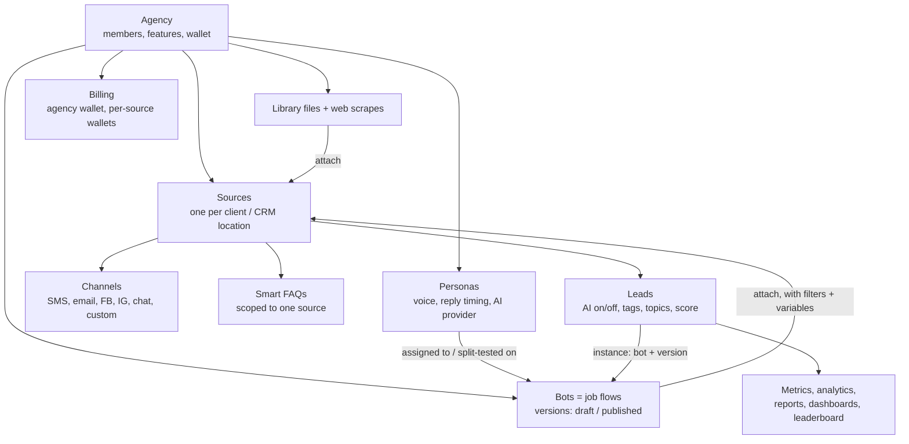
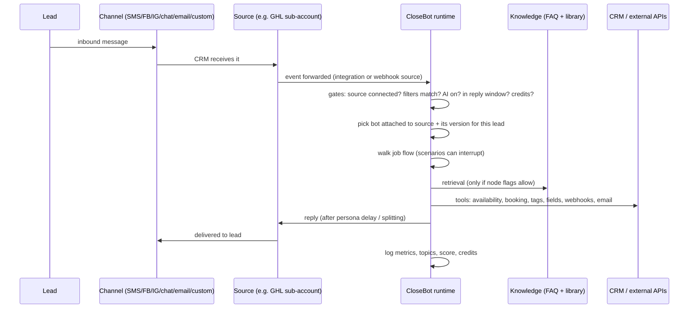
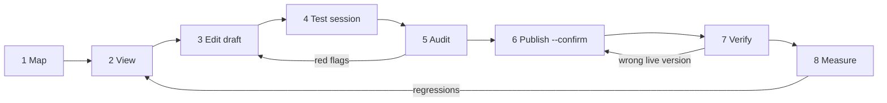

# How CloseBot works — the mental model

Load this first when you need to reason about CloseBot as a system rather than call one
endpoint. It covers what the objects are, how a lead's message moves through them, what the
API can and cannot reach, how to change things safely, and where things usually break.

This is an unofficial summary written for this harness. For CloseBot's own explanations go
to the help center at <https://docs.closebot.com>; for the API reference go to
<https://developers.closebot.com>. Anything tagged **unverified** has not been confirmed
against a live account or an authoritative source. Treat it as a hypothesis and check it
before you rely on it.

Endpoints are written as `METHOD /path` on `https://api.closebot.com` unless stated
otherwise. Every one of them appears in [`../schema/openapi.json`](../schema/openapi.json).
Prefer the `cb` CLI over raw HTTP (see [`../skills/closebot/SKILL.md`](../skills/closebot/SKILL.md)).

---

## 1. The object model in one picture

The short version:

- An **agent** is a persona combined with a job flow. The API calls the job flow a
  **bot**.
- Agents attach to **sources**. A source is where messages come from.
- Knowledge attaches to **sources**, not to bots. Every bot attached to a source can see
  that source's knowledge, as long as the right retrieval flags are switched on (see §4).

### 1.1 Objects, what they mean, and where to read them

| Object | What it is | Read it with | Notes |
|---|---|---|---|
| **Agency** | The top-level account. It holds members, features and the wallet | `GET /agency/current`, `GET /agency` | Invite teammates with `POST /agency/invite` |
| **API key** | Per-account credential, sent as the `X-CB-KEY` header | `GET /account/apiKey` | The secret is shown once, when the key is created in the UI. Never log it |
| **Source** | One connected CRM location or channel host. In practice this is usually one GHL sub-account per client. Other kinds: LeadConnector, HubSpot, a blank source, or a custom webhook source | `GET /agency/source`, `GET /agency/source/{id}` | Carries reply windows, do-not-respond windows, auto-shutoff, timezone, a wallet, and the list of attached bots |
| **Source lookups** | The CRM data a bot can use on that source | `GET /agency/source/{id}/calendars`, `/channels`, `/fields`, `/tags`, `/owners` | Calendar IDs for booking come from here |
| **Custom channel** | A channel defined by a provider plus a unique ID, added to a source | `GET /agency/source/{sourceId}/custom-channels` | Deleting one is Tier 2 |
| **Webhook integration** | Two-way bridge for a blank or custom source: inbound mapping, outbound send template, optional contact fetch | `GET /agency/source/{sourceId}/webhook-integration`, `GET …/webhook-integration/events` | Configure with `PUT …/inbound`, `PUT …/outbound`, `PUT …/contact-fetch` |
| **Bot** | A job-flow graph plus metadata: versions, attached sources, persona IDs and weights, follow-up config, account-level tools | `GET /bot`, `GET /bot/{id}` | `versions[]` holds `{version, published}`. Several versions exist over time |
| **Job flow (steps)** | The graph itself. Top-level keys: `nodes`, `edges`, `variables` (including Job Information and persona blocks), `customTools`, `enabledGlobalToolNames`, `mcpServers` | `GET /bot/{id}/steps?botVersion=<v>` | Always pass `botVersion`, even though the spec marks it optional ([`../GOTCHAS.md`](../GOTCHAS.md)) |
| **Node catalogue** | 27 atomic node types in 6 groups, plus 5 account-level tools | `GET /bot/nodeDescriptors` → [`../schema/node-descriptors.json`](../schema/node-descriptors.json) | Per-node detail: [`AGENT-BUILDING.md` §2](./AGENT-BUILDING.md) |
| **Bot ↔ source attachment** | The link between a bot and a source. It carries tag filters, channel rules, a per-source persona-name override, `enabled`, and `flowVariableValues` | `POST /bot/{id}/source/{sourceId}` (attach), `DELETE …` (detach) | If you attach with an empty body, the source variables become `""` and override their defaults (GOTCHAS 2026-09-05) |
| **Source variables** | Per-source values for flow variables, so one job flow can behave differently for each business | `GET /botVariables/{botId}/{sourceId}`, `POST /botVariables/{botId}/{sourceId}` | A successful POST returns an empty body |
| **Persona** | Voice, how to respond, typo rate, message splitting, reply delay, AI-provider preferences | `GET /persona`, `GET /persona/{id}` | `PUT /persona/{id}` has a side effect that flips the `default` flag (see §3) |
| **Persona split test** | Two or more personas on one bot with traffic weights, scored on sentiment or lead score | `GET /bot/{id}/persona-split-tests`, `GET /bot/{id}/persona-performance` | End a test with `POST /bot/{id}/persona-split-test/end`. The help center says this needs the paid Analytics add-on |
| **Library file / web scrape** | Uploaded documents (TXT > CSV > DOCX > PDF, in order of reliability) and scraped pages | `GET /library/files`, `GET /library/files/{fileId}/view` | Upload with `POST /library/files` or `POST /library/webscrape`, then **attach** with `POST /library/files/{fileId}/source/{sourceId}` |
| **External library** | Knowledge synced from an external provider | `GET /library/external/{provider}/connections` | Recent in the spec. Behaviour is **unverified** |
| **Smart FAQ** | Q&A pairs scoped to one source. The SmartFAQ tool can also collect unanswered questions here | `GET /smart-faq?sourceId=…` | Add with `POST /smart-faq`, answer with `POST /smart-faq/answer` |
| **Lead** | One contact on one source. Carries last message, failure reason, tags, fields, score, and `instances[]` (bot ID + bot version) | `GET /lead`, `POST /lead/search`, `GET /lead/{leadId}` | Also: `GET /lead/{leadId}/topics`, notes, scheduled messages |
| **AI toggle** | Per-lead on/off switch for the AI. The response includes `applicable` and `reason` | `GET /lead/{leadId}/ai-toggle`, `PUT /lead/{leadId}/ai-toggle` | Auto-shutoff on a manual reply and "AI off" tags also stop replies |
| **Metrics** | Counts, actions, logs, messages, booking graph, feedback | `GET /botMetric/agencySummary`, `/messageCount`, `/actionCount`, `/logs`, `/messages`, `/bookingGraph` | [`endpoints/botmetric.md`](./endpoints/botmetric.md) |
| **Analytics** | Query engine for metrics, dimensions and topics | `GET /analytics/metrics`, `POST /analytics/query`, `POST /analytics/topics` | The POSTs are read-only queries, but they count as Tier 1 because of the HTTP method |
| **Reports / dashboards** | Saved analytics views. Reports can be shared with other accounts | `GET /report`, `GET /dashboard` | Revoking or replacing shares is Tier 2 |
| **Leaderboard** | Cross-account ranking | `GET /leaderboard/board`, `/metrics`, `/profile` | Read-only |
| **Billing** | Agency wallet, per-source wallets, usage, re-billing to clients, AI cost breakdown | `GET /agency/billing/balance`, `GET /agency/billing/balance/source/{sourceId}`, `GET /agency/billing/usages`, `GET /agency/billing/ai-cost-breakdown` | Refills charge real money: `POST /agency/billing/refill` is Tier 2 |
| **Folders** | Organisational tree for bots and personas | `GET /hierarchy` | |
| **Live demo / share link** | A public demo session for a bot | `GET /bot-live-demo/{botId}` | Separate from test sessions |

### 1.2 Inside a job flow

- **Main path.** Execution starts at the `Source` node and follows edges keyed by output
  handles. It stops at `End` (Stop Responding), or pauses to wait for the lead's next
  message.
- **`Method` (Agent) nodes carry most of the logic.** Each one has `Instructions`,
  `Sections[]` and `EnableXxx` tool flags: booking, availability, tags, contact update,
  Smart FAQ, library context, email, and so on. `MultiObjective` collects several fields at
  once.
- **Scenarios are interrupts.** `ScenarioAggression`, `ScenarioBotDetection`,
  `ScenarioGoodbye` and `ScenarioCustom` sit outside the main path and can take over from
  any point in the conversation.
- **Job Information.** The business facts ("why the conversation is happening" and
  "important business information") live under `variables.business`. There are two shapes:
  `overallPromptSections[]`, or the flat `whyText`/`importantText`. This data is **not** in
  the Method node Sections. See
  [`../skills/closebot-repurpose-bot/references/repurpose-mechanics.md`](../skills/closebot-repurpose-bot/references/repurpose-mechanics.md).
- **Account-level tools** (`SmartFAQ`, `Email`, `SummarizeConversation`,
  `TranscribeConversation`, `SmartFollowUp`) are saved with `POST /bot/{id}/saveTools`.
  The body must be a raw JSON array, and the call replaces the whole set, so it is Tier 2.
- **Custom tools** are HTTP tools the model can call mid-conversation, defined in
  `customTools[]`. GOTCHAS 2026-09-05 records that tool-call parameters were never observed
  being bound into the request. Treat parameter binding as **unverified or broken** until
  you have re-tested it.
- **Custom WebHook node.** An outbound HTTP call inside the flow. Its response can feed
  variables used by later nodes. See [`05-webhooks.md`](./05-webhooks.md).

---

## 2. A lead's journey, end to end

1. **Inbound.** A message arrives on a channel that belongs to a source. With a GHL or
   LeadConnector source, the CRM forwards the event to CloseBot through the marketplace
   integration. With a blank or custom source, your system posts the event to the inbound
   webhook that the source's webhook integration defines.
2. **Gates.** Any of the following stops a reply: the source is not in this account or is
   disconnected; a tag or channel filter on the bot↔source attachment excludes this lead;
   the lead is AI-off (toggle, "AI off" tag, or auto-shutoff after a human replied); the
   message falls outside the source's reply window; the account is out of credits or the
   wallet is negative; the AI provider is down. The help center's "agent not responding"
   article gives the same checklist. Separately, a bot with no usable persona produces no
   reply and reports `mostRecentFailureReason: "no_persona"`.
3. **Bot and version.** The bot that answers is the one attached to the source whose filters
   match. Each lead records `instances[]` as `{botId, botVersion}`, which you can change
   with `PUT /lead/{leadId}/instance/{botId}`. **Unverified:** how CloseBot chooses between
   several bots that match the same lead, and exactly when a newly published version starts
   serving existing leads (see §3).
4. **Job flow execution.** The runtime walks from the current node. It fills in variables,
   Job Information, source variables and the `{{location.*}}` CRM merge fields. Because the
   merge fields resolve against the *attached* source, a duplicated bot still attached to
   the wrong source will use the wrong client's data.
5. **Knowledge retrieval** happens only through tools the node allows. `EnableSmartFaq`
   searches the source's Smart FAQs. `EnableLibraryContext` searches library files attached
   to the source. These are **separate paths**: switching on one does not switch on the
   other. A blank Job Information label (for example `Office Hours:` with nothing after it)
   can make the model decide it doesn't know the answer and skip retrieval altogether.
6. **Tools and side effects.** Depending on the node, the runtime can:
   - check availability and book, reschedule or cancel on a GHL calendar
   - add or remove tags, which is also how handover is usually signalled
   - write CRM fields
   - send email
   - call custom tools or webhooks
   - summarise or transcribe the conversation into the CRM
   - schedule a smart follow-up
7. **Reply.** Text goes back through the source's channel. Persona settings shape how it is
   delivered (reply delay, message splitting, typos), and a source can override the persona
   name. Follow-ups run later, inside the follow-up restriction windows.
8. **Measurement.** Messages, actions, bookings, topics, sentiment and lead score feed
   `/botMetric/*`, `/analytics/*`, reports, dashboards, the leaderboard and persona
   split-test results. Usage is also charged to the agency wallet and, if re-billing is on,
   to the source wallet.

### 2.1 Live message plane vs REST management plane

| | Live message | REST management |
|---|---|---|
| URL | `POST https://api.closebot.ai/message` | `https://api.closebot.com/*` |
| Job | Runtime. Pushes one inbound message into the engine and gets a reply | Configuration and read APIs: bots, sources, KB, leads, billing, metrics |
| Auth | `X-CB-KEY` or body `api_key`. Repo docs say it can be unauthenticated when `id` resolves to a contact in an integrated GHL source | `X-CB-KEY` header |
| Statuses | Non-standard: `410` no account, `420` no credits, `430` no id, `440` no message, `450` bot limit, `460` account limit (threshold undocumented) | Ordinary HTTP |
| Reply | Non-integrated: returned in the body. Integrated: delivered out-of-band through the CRM, so the body carries no reply | n/a |
| Safety | **Tier 1, and it sends a real message to a real person.** Never call it with made-up IDs | Tiered per [`SAFETY.md`](./SAFETY.md) |

Details: [`06-live-message.md`](./06-live-message.md). **Unverified:** the published list of
`model` values (default `text-davinci-003`) looks out of date. Don't assume which model
actually runs.

For development, use **test sessions** instead of live messages. They are isolated and
never touch real channels:

- `POST /bot/{botId}/testSession` creates a session.
- `PUT /bot/{botId}/testSession/{leadId}` sets `mimicSourceId`.
- `POST /bot/{botId}/testSession/message` sends a message.
- `GET /bot/{botId}/testSession/messages/{leadId}` reads the SSE stream, which includes tool
  calls and logs. It long-polls, so always bound it with a timeout.
- `cb bot test` wraps all of this.

A new test session has **no source context** by default. Set `mimicSourceId` before the
first message, or the source's variables and KB will be invisible.

[`AGENT-BUILDING.md`](./AGENT-BUILDING.md) §5 and
[`CLIENT-MANAGEMENT.md`](./CLIENT-MANAGEMENT.md) §3 follow the same test-session rule.

---

## 3. What the API can and cannot do

| Task | API? | Where it's recorded |
|---|---|---|
| Connect a new GHL / LeadConnector source (OAuth, marketplace install) | **No, UI only** | [`SAFETY.md`](./SAFETY.md) rule 5, [`CLIENT-MANAGEMENT.md` §11](./CLIENT-MANAGEMENT.md) |
| Re-point a duplicated bot at the right client's source | **Treat as UI only.** Attach and detach calls exist (`POST`/`DELETE /bot/{id}/source/{sourceId}`), but the source has to be connected already, and GOTCHAS 2026-06-22 records reassignment as an OAuth/UI gate | [`../GOTCHAS.md`](../GOTCHAS.md) |
| Assign a persona to a bot | **Treat as UI only.** `UpdateBotInput` does include `personaIds`/`personaWeights`, but the repo's verified path is the UI, and `PUT /persona/{id}` flips `default=true` in a way the API cannot undo. API assignment through `PUT /bot/{id}` is **unverified** | GOTCHAS 2026-06-22, CLIENT-MANAGEMENT §11 |
| Assign a published version to a source's channels | Repo notes describe this as a UI step, and **it is unverified whether it's required** before live leads get the new version. Safer rule, used in every doc in this harness: **treat a publish as able to affect live leads immediately**, and also check the channel assignment in the UI | [`SAFETY.md`](./SAFETY.md), [`AGENT-BUILDING.md` §5](./AGENT-BUILDING.md) |
| Subscribe to platform events | **Not offered.** Outbound calls come only from WebHook nodes and custom tools | [`05-webhooks.md`](./05-webhooks.md) |
| Create a blank or custom-webhook source | `POST /agency/source` exists (`AddSourceInput`). **Unverified** for non-OAuth kinds | — |
| Body of `POST /webhook/event/{sourceId}` | Not described in the spec. **Unverified** | [`05-webhooks.md`](./05-webhooks.md) |
| Everything else: bots, steps, tools, attach, variables, KB, FAQ, leads, AI toggle, metrics, billing reads | Yes | [`endpoints/`](./endpoints/) |

Spec drift is real and ongoing: the spec says one thing and the server does another. See
[`../skills/learned/rest-api-spec-drift/`](../skills/learned/rest-api-spec-drift/) and run
`cb spec refresh` to update the spec. Two traps: `GET /library/files?sourceId=` ignores the
filter and returns the whole account, and a successful publish returns `"message":"null"`
as a literal string. The vendor docs MCP is for searching docs only; its generated skill
gives the wrong auth header and wrong paths.

---

## 4. The safe operating loop for any change

| Step | Do | Tool / skill | Tier |
|---|---|---|---|
| 1. Map | Inventory the agency, sources, bots and versions, parity, personas and KB | `cb doctor`, `cb map` → `closebot-map` | 0 |
| 2. View | Read the target bot in full and scan it for red flags. Run `closebot-pre-flight` before anything touches a specific bot | `cb bot audit <id> --json` → `closebot-view-agent` | 0 |
| 3. Edit draft | Resolve the target with `cb bot version <id>` (never hardcode it, and don't trust "last unpublished" once the head is published). Then `pull` → mutate → `push`. Close the UI editor first, because autosave can fork the draft. `invalidPaths` must be `[]` | `closebot-edit-job-flow`, `-build-job-flow`, `-add-scenario`, `-apply-template`, `-repurpose-bot`, `-attach-knowledge` | 1 |
| 4. Test | Run a sandbox session against a real source using `mimicSourceId`. Only bots listed in `cli/sandbox.json` are valid write-test targets | `cb bot test <id> "msg" [--lead]`, `closebot-quality-audit` | 1 (cleanup is exempt) |
| 5. Audit | Framework parity must be `true`, with no `FAIL` red flags. Loop back to step 3 until clean | `closebot-audit-loop` (never publishes) | 0–1 |
| 6. Publish | Preview with `--dry-run` and show the diff. Get an explicit same-turn yes, then `--confirm`. Never chain with another Tier 2 call | `closebot-publish-safely` | **2** |
| 7. Verify | Re-read `GET /bot/{id}` and check that the target version is `published==true`. Assume it is already live. Also check that the version is assigned to channels in the UI (unverified whether that's required) | `cb bot version <id>` | 0 |
| 8. Measure | Compare metrics, logs and feedback before and after | `/botMetric/*`, `/analytics/*`, `closebot-quality-audit` | 0 |

Two exceptions to "nothing is live until you publish":

- `PUT /library/files/{fileId}` replaces a file's content, and the change goes live as soon
  as the file is re-indexed.
- Smart FAQ edits and the lead AI toggle also take effect immediately.

Neither passes through the publish gate. There is no rollback endpoint: to roll back,
re-save an older version's steps as a new draft and publish that.

---

## 5. Common failure modes and where to look

Start with [`../skills/closebot-debug-bot/SKILL.md`](../skills/closebot-debug-bot/SKILL.md)
(symptom-driven) and [`../GOTCHAS.md`](../GOTCHAS.md). Newest entries are at the top.

| Symptom | Usual cause | Look at |
|---|---|---|
| No reply at all | No source attached; filters exclude the lead; lead is AI-off; outside the reply window; `no_persona`; out of credits (`420`) | `cb bot audit` (sources, persona), `GET /lead/{leadId}/ai-toggle`, `GET /agency/billing/balance`, the source's settings |
| Says "not 100% sure" even though the KB is loaded | `EnableLibraryContext` is off; file not attached or not ready; blank Job Information label; empty source variable; test session without `mimicSourceId` | `cb kb verify`, red flags `KB_DISABLED` / `EMPTY_LABEL_VALUE` / `EMPTY_FLOW_VARIABLE` |
| Books the wrong calendar | An old calendar ID left in Section bodies or `Instructions`, not just in the calendar field | `cb bot audit` → `MISSING_CALENDAR`, inline calendar-leak flags |
| Mentions another client's brand, staff, price or deposit | A duplicate inherited Job Information, Method text, persona metadata, or an entire deposit node | `closebot-repurpose-bot`, whole-payload grep |
| Your fix "didn't take" | You edited a stale draft; the version isn't published or assigned; UI autosave clobbered the save | `cb bot version`, `DRAFT_LIVE_DRIFT` |
| Ends conversations too early | A scenario trigger that is too loose | `.scenario_nodes` in the audit |
| `saveTools` returns 400 / `save` returns 400 | Body wrapped as `{tools:[…]}` (must be a raw array); `botSteps` wrapper missing | [`AGENT-BUILDING.md` §10](./AGENT-BUILDING.md) |
| Custom tool ignores its arguments | Parameters are not bound (GOTCHAS 2026-09-05) | Test-session SSE `tool_use` and `logs` |

---

## 6. Which skill for which job

| User intent | Skill |
|---|---|
| General CloseBot question, auth, which endpoint | `closebot` |
| "What's in my account", inventory, health check | `closebot-map` |
| Before touching any specific bot | `closebot-pre-flight` |
| Read or explain one bot's configuration | `closebot-view-agent` |
| "Bot is misbehaving / why did it say X" | `closebot-debug-bot` |
| Onboard a new client end to end | `closebot-onboard-client` |
| Design a flow from scratch | `closebot-build-job-flow` |
| Change one property on an existing bot | `closebot-edit-job-flow` |
| Add an aggression, bot-detection, goodbye or custom interrupt | `closebot-add-scenario` |
| Bring a diverged bot up to the template framework | `closebot-apply-template` |
| Re-point a duplicated bot at a new client or offer | `closebot-repurpose-bot` |
| Upload or update docs, FAQs or scrapes | `closebot-attach-knowledge` |
| The same change across many bots, sources or leads | `closebot-bulk-fanout` |
| Audit → fix → re-audit until clean (never publishes) | `closebot-audit-loop` |
| Grade real conversation quality (CB-XXX findings) | `closebot-quality-audit` |
| Ship a draft live (Tier 2) | `closebot-publish-safely` |
| After a skill runs: log a gotcha or improve the skill | `skill-retro` |
| The spec and the server disagree | `learned/rest-api-spec-drift` (reference) |

---

## 7. Glossary

| Term | Meaning |
|---|---|
| **Agent** | A persona combined with a job flow. In the API this is a "bot" |
| **Bot** | The API object that holds a job flow, its versions, its tools and its source attachments |
| **Job flow / steps** | The node-and-edge graph that decides what the agent does next |
| **Draft / published version** | Every save writes to a version (`0.0.N`). Publishing marks a version published; treat it as live immediately. Old versions are kept |
| **Source** | A connected message origin, usually one client's CRM location |
| **Channel** | The medium the message travels on: SMS, email, FB, IG, WhatsApp, live chat, or a custom channel |
| **Source filter** | Tag and channel rules on a bot↔source attachment that decide which leads a bot answers |
| **Source variable** | A per-source value for a flow variable (`flowVariableValues`) |
| **Job Information** | Flow-level business facts in `variables.business` |
| **Method node** | The LLM "Agent" node, with instructions, sections and tool flags |
| **MultiObjective** | A node that gathers several data points and can write them to the CRM |
| **Scenario** | An interrupt node that can override the main path from anywhere in the conversation |
| **Account-level tools** | SmartFAQ, Email, SummarizeConversation, TranscribeConversation and SmartFollowUp, set per bot through `saveTools` |
| **Custom tool** | A bot-defined HTTP tool the model can call |
| **Smart FAQ** | Q&A pairs scoped to one source |
| **Library** | Uploaded files and web scrapes, which must be attached to a source before a bot can use them |
| **Persona** | Voice, reply style, timing and AI-provider preferences |
| **Split test** | A weighted persona A/B test scored on sentiment or lead score |
| **Lead instance** | A lead's binding to a bot and bot version |
| **AI toggle** | Per-lead switch that pauses the AI so a human can take over |
| **Handover** | A tag (commonly added by a scenario or the Agent node) that tells humans to take over |
| **Test session** | A sandbox conversation that never reaches a real channel |
| **`mimicSourceId`** | Makes a test session behave as though it came from a real source |
| **Live message** | `POST https://api.closebot.ai/message`, the runtime plane |
| **Tier 0/1/2** | This harness's risk classes: read / mutate / destructive, live, or money ([`SAFETY.md`](./SAFETY.md)) |
| **Framework parity** | Whether a bot has the template's recommended agent-node set (`cb bot audit`) |
| **Red flag** | An audit finding with `FAIL` or `WARN` severity. `FAIL` blocks publishing |
| **Wallet / re-billing** | Prepaid credit at agency and source level. Re-billing passes usage on to client wallets |
| **`cb`** | This harness's CLI (`cli/cb`) |

---

## 8. Unverified — confirm before relying on these

1. Whether publishing changes what live leads receive immediately, or only after a version
   is assigned to channels in the UI. The docs assume the safer "immediately", but some
   skills still say otherwise.
2. Whether `PUT /bot/{id}` with `personaIds`/`personaWeights` reliably assigns a persona.
3. How CloseBot picks a bot when several attached bots match the same lead, and when an
   existing lead's `instances[].botVersion` moves to a newly published version.
4. Creating non-OAuth sources through `POST /agency/source`.
5. The request body of `POST /webhook/event/{sourceId}`.
6. Which `model` values the live message endpoint currently accepts.
7. The threshold behind live-message status `460`, and the enum values for library
   `fileStatus`.
8. Whether custom-tool parameters are bound into requests (observed not to be).
9. How the external library providers (`/library/external/{provider}/*`) behave.
